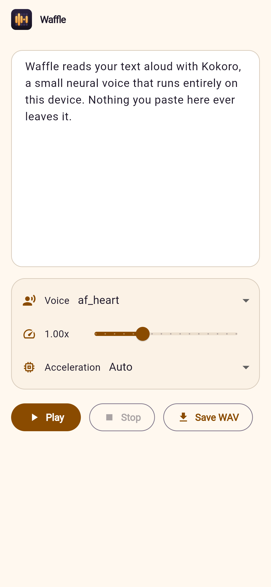
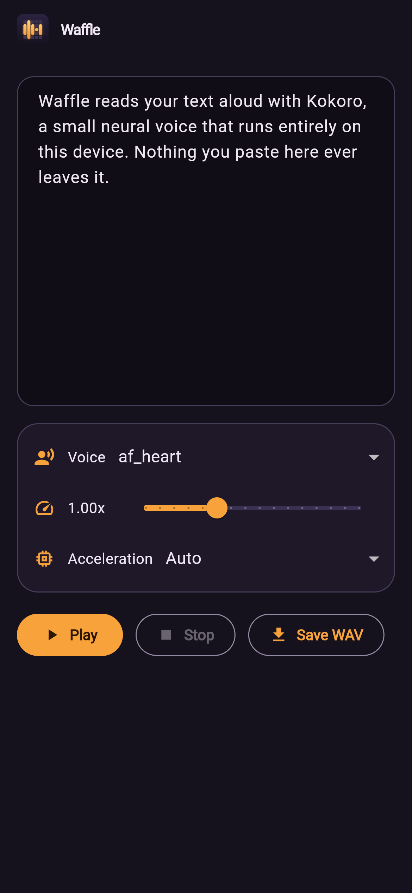

<p align="center">
  
</p>

# Waffle

**Reads aloud. Stays on your device.** Waffle is a client-side TTS app: it reads
text and websites aloud using **Kokoro 82M** or the small **KittenTTS nano**, fully
on device, with no server and no account. (The repository and bundle id keep the
original codename, *glowing-waffle* / `dev.luen.glowingwaffle`.)

<p align="center">
  
  &nbsp;
  
</p>

> Kitten is native-only (Android/iOS/macOS). The web engine keeps speaking with Kokoro through kokoro-js, where the model picker is hidden rather than faked.

## Platforms

- **Web**: Kokoro 82M via kokoro-js, on WebGPU when available and WASM otherwise. Open the app in a browser and use the text field. The text field's **Acceleration** dropdown overrides the execution backend (`Auto`, `GPU (WebGPU)`, `CPU (WASM)`) — pick CPU if WebGPU output sounds garbled on your machine.
- **Android / iOS / macOS**: Kokoro 82M or KittenTTS nano via Sherpa-ONNX. The selected model is **downloaded on first run** instead of being bundled (~350 MB for Kokoro, ~25 MB for Kitten), so the app itself stays small; the **Model** dropdown switches between them and the setup card names the one that is missing. Includes a **Web Reader** tab to load a URL and read extracted text aloud.

On every platform **Save WAV** writes the current text (or the Web Reader page) to a
single 24 kHz WAV file: a download on web, the Downloads folder on desktop, and
the system share sheet on Android and iOS. See [Saving audio](#saving-audio).

## Saving audio

**Save WAV** next to Play writes the current text (or the Web Reader page) to
one file:

- **Web**: the bytes become a Blob and the browser downloads them
  (`downloadWav()` in `web/tts_bridge.js`).
- **macOS / Windows / Linux**: the `Downloads` folder. The macOS sandbox needs
  `com.apple.security.files.downloads.read-write` in `macos/Runner/*.entitlements`.
- **Android / iOS**: the system share sheet. Neither platform lets an app write
  to a shared, user-visible folder without a picker — on Android
  `getDownloadsDirectory()` resolves to
  `/storage/emulated/0/Android/data/<package>/files/Download`, which no file
  manager or USB transfer shows (issue #17). The share sheet keeps the choice
  with the user: Files, Drive, a chat, a mounted drive…

Multi-sentence input and whole Web Reader pages become a single WAV: both
platforms render sentence chunks and join them with a short pause. Native builds
reuse the chunks playback already rendered and only synthesize what was not
played yet, so the file matches what you heard; web renders the text again
(#64). Nothing is written until Save is pressed, and the confirmation names the
file and where it went.

## Setup

1. **Flutter**  
   Install [Flutter](https://docs.flutter.dev/get-started/install) and ensure `flutter doctor` passes.

2. **Dependencies**  
   From the project root:

   ```bash
   flutter pub get
   ```

3. **Native (Android/iOS/macOS) – speech model**  
   Nothing to do: the first run shows a *Voice model needed* card and downloads
   the selected model (Kokoro 82M, ~350 MB, or the much smaller Kitten nano,
   ~25 MB) into the app's support directory, where it stays put. The download is
   checksum-verified and only the files the engine reads are kept. Switching
   models in the **Model** dropdown downloads that model the same way, so both
   can be installed side by side.

   For an **offline development build**, stage the files instead and the app
   imports them without downloading. Kokoro's files go into `assets/tts/`,
   Kitten's into `assets/tts_kitten/`; both are described by
   `lib/tts/tts_models.dart`:

   - Kokoro: `model.onnx`, `tokens.txt`, `voices.bin`, `lexicon-us-en.txt`, `espeak-ng-data.zip`
   - Kitten: `model.fp16.onnx`, `tokens.txt`, `voices.bin`, `espeak-ng-data.zip`
   - `espeak-ng-data.zip` is the espeak-ng phonemizer data, zipped because Flutter assets are not recursive; the app extracts it on first run.

   **Linux / macOS:**

   ```bash
   scripts/download_tts_model.sh        # assets/tts/
   scripts/download_tts_model.sh kitten # assets/tts_kitten/
   ```

   **Windows (PowerShell):**

   ```powershell
   .\scripts\download_tts_model.ps1
   .\scripts\download_tts_model.ps1 kitten
   ```

   The script downloads the matching sherpa-onnx release ([kokoro-multi-lang-v1_0](https://github.com/k2-fsa/sherpa-onnx/releases/download/tts-models/kokoro-multi-lang-v1_0.tar.bz2), [kitten-nano-en-v0_2-fp16](https://github.com/k2-fsa/sherpa-onnx/releases/download/tts-models/kitten-nano-en-v0_2-fp16.tar.bz2)) and stages the files above. Then re-add the directory to `pubspec.yaml` under `flutter:` (`assets: [assets/tts/]` or `assets: [assets/tts_kitten/]`) — it is deliberately absent, so without that line the files are ignored (and, importantly, not copied into `build/web`).

   Point a build at other archives with `--dart-define=KOKORO_MODEL_URL=… --dart-define=KOKORO_MODEL_SHA256=…` or `KITTEN_MODEL_URL` / `KITTEN_MODEL_SHA256`.

## Run

1. **Web** (no model download needed; Kokoro loads in-browser):

   ```bash
   flutter pub get
   flutter run -d chrome
   ```

   Or build: `flutter build web` and serve `build/web`.

2. **Android** (downloads the model on first run):

   ```bash
   flutter pub get
   flutter run -d android
   ```

   Release builds are **arm64-v8a only**: the models are CPU-bound, so 32-bit
   phones and x86 emulators are not realistic targets (issue #40).
   `android/app/build.gradle.kts` drops the other ABI folders under
   `packaging`, and the release workflow builds with:

   ```bash
   flutter build apk --release --target-platform android-arm64
   flutter build appbundle --release --target-platform android-arm64
   ```

   That produces one ~44 MB APK with the plain `versionCode` (instead of the
   126 MB universal APK), and the workflow asserts the APK contains only
   `arm64-v8a`. `flutter run` on an x86_64 emulator no longer works — use a
   physical device.

3. **iOS**  

   ```bash
   flutter pub get
   flutter run -d ios
   ```

4. **macOS**  

   ```bash
   flutter pub get
   flutter run -d macos
   ```

## Signing release builds

Android release builds are **debug-signed** unless an upload key is configured,
so `flutter run --release` works on a fresh checkout but the artifact cannot be
published. Give Gradle the key in `android/key.properties` (git-ignored):

```properties
storeFile=/absolute/path/to/upload.jks
storePassword=…
keyAlias=upload
keyPassword=…
```

or through the equivalent environment variables (`ANDROID_KEYSTORE_PATH`,
`ANDROID_KEYSTORE_PASSWORD`, `ANDROID_KEY_ALIAS`, `ANDROID_KEY_PASSWORD`). The
release workflow uses the environment form: it writes `android/key.properties`
from the `ANDROID_KEYSTORE_BASE64`, `ANDROID_KEYSTORE_PASSWORD`,
`ANDROID_KEY_ALIAS` and `ANDROID_KEY_PASSWORD` secrets, prints the signing
certificate, and stays debug-signed (with a log line saying so) when the
secrets are absent.

iOS and macOS release signing still needs an Apple Developer account plus the
matching certificates, provisioning profiles and notarization credentials
(issue #11).

## Checking it works (CPU, no device needed)

```bash
# Flutter: lint, widget tests, web build
flutter analyze && flutter test && flutter build web

# Native engine: same sherpa-onnx configs as lib/tts/tts_engine_mobile.dart
scripts/download_tts_model.sh
scripts/download_tts_model.sh kitten
python3 -m venv .venv && . .venv/bin/activate
pip install -r scripts/requirements.txt
python scripts/smoke_tts.py --out native-smoke.wav "Hello from Glowing Waffle."
python scripts/smoke_tts.py --engine kitten --out kitten-smoke.wav

# Web engine: same kokoro-js model and audio handling as web/tts_bridge.js
cd scripts/web_smoke && npm ci && node smoke.mjs ../../web-smoke.wav
```

CI (`.github/workflows/ci.yml`) runs all of the above and uploads the WAVs as an
artifact. It also does a release-mode Android build (arm64) and, on a macOS
runner, release builds for macOS and iOS (`--no-codesign`), so AGP/Gradle and
Xcode/plugin breakage shows up in a PR instead of at tag time.

## Project layout

- `lib/` – Flutter app (Riverpod state, screens, TTS bridge).
- `lib/tts/` – TTS engine interface and platform implementations (web vs native), plus `tts_models.dart` (models, voices and their archives) and `model_store.dart` (first-run model download).
- `web/` – Web entry and `tts_bridge.js` (Kokoro via kokoro-js and Web Audio).
- `assets/tts/`, `assets/tts_kitten/` – optional staged model files for offline development (`scripts/download_tts_model.sh [kokoro|kitten]`); not bundled unless declared in `pubspec.yaml`.

## Architecture

- **UI**: Single app with a **Text** tab (all platforms) and **Web Reader** tab (Android, iOS, macOS only; hidden on web).
- **Bridge**: `TtsEngine` is implemented by `tts_engine_web.dart` (web) and `tts_engine_mobile.dart` (native), selected via conditional imports.
- **Web**: `tts_bridge.js` loads Kokoro, caches in session, and plays via the Web Audio API. Dart calls it with `dart:js_interop`.
- **Native**: Sherpa-ONNX loads the selected model — Kokoro 82M (with espeak-ng data and an en-US lexicon) or KittenTTS nano — from the app support directory, where it was downloaded and checksum-verified on first run, generates PCM, writes WAV to a temp file, and plays with `just_audio`.
- **Saving**: `TtsEngine.renderSamples()` returns the PCM for a save (native: one sherpa-onnx `generate` call; web: `renderSamples()` in the bridge), `lib/tts/wav.dart` encodes it as 16-bit mono WAV, and `lib/tts/audio_saver.dart` writes it — a Blob download on web, a file in a user-visible folder on native.

## Third-party licences

See [`THIRD_PARTY_NOTICES.md`](THIRD_PARTY_NOTICES.md). The models and libraries
are permissively licensed (Apache-2.0/MIT) with one exception: sherpa-onnx
compiles **espeak-ng (GPL-3.0-or-later)** into the native library every native
build ships, so native builds contain GPL-3.0 code (open question and tracking
in #32). The licence texts themselves are in [`LICENSES/`](LICENSES/): GPLv3 for
espeak-ng and Apache-2.0 for sherpa-onnx and the models. Waffle's own licence is
not decided yet.

## Branding

Name, icon, palette, splash screens and store artwork are described in
[`docs/branding.md`](docs/branding.md); every icon size is generated from one
script, `scripts/branding/export.mjs`.
