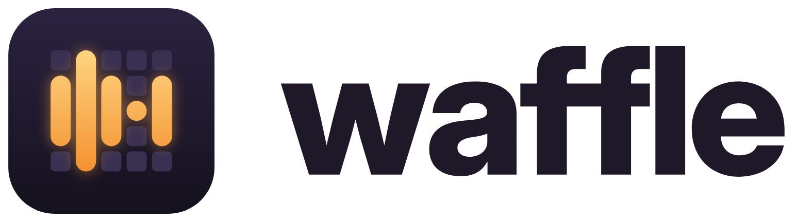
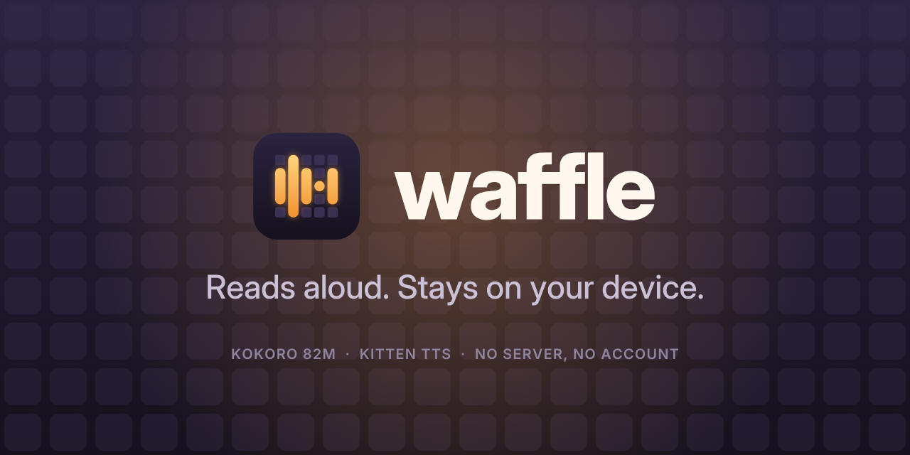

# Branding

<p align="center">
  
</p>

What the app looks like: its name, mark, icons, palette, type and the artwork
around it. Issue #65 made the decisions; this file records them and is the map
for whoever changes them. Read it before touching an icon, a colour or the app's
name.

## Name

**Waffle.** To *waffle (on)* is to talk at length, which is exactly what the app
does with your text, and it keeps the codename's waffle.

| Where | Value |
| --- | --- |
| Display name, every platform | `Waffle` |
| Wordmark | lowercase **waffle**, only in the logo lockup |
| Prose and UI | "Waffle", capitalised |
| Tagline | *Reads aloud. Stays on your device.* |
| Repository, Dart package, bundle id | unchanged: `glowing-waffle`, `glowing_waffle`, `dev.luen.glowingwaffle` |

The bundle id **must stay `dev.luen.glowingwaffle`**: changing it installs a
second app and abandons the downloaded model (#41). The name lives in:

| Platform | File |
| --- | --- |
| Android | `android:label` in `android/app/src/main/AndroidManifest.xml` |
| iOS | `CFBundleDisplayName` and `CFBundleName` in `ios/Runner/Info.plist` |
| macOS | `PRODUCT_NAME` in `macos/Runner/Configs/AppInfo.xcconfig`, so the bundle is `Waffle.app` (the Xcode project, scheme and `.github/workflows/release.yml` refer to it by that name) |
| Web | `web/manifest.json` (`name`, `short_name`), `web/index.html` (`<title>`, `apple-mobile-web-app-title`) |
| App | `AppTitle.name` in `lib/widgets/app_title.dart` (app bar and `MaterialApp.title`, which is the macOS window and browser tab title) |
| README | heading and header image |

## Mark and icon

<p align="center">
  
</p>

A 5×5 waffle on a night tile. Some of its pockets are filled with glowing honey,
and the filled columns (heights 3, 5, 3, 1, 3, centred) read as a voice
waveform: text turning into speech. The unlit cells keep the waffle legible; the
lit bars are what survives at 16 px.

- The geometry lives in one place, `scripts/branding/export.mjs`
  (`MARK_HEIGHTS`, cell 100, gap 26, radius 22, in a 604-unit square). The
  in-app vector copy, `WaffleMark` in `lib/theme/waffle_mark.dart`, mirrors it;
  change both together.
- The mark fills 59% of a full-bleed icon. That keeps it inside Android's 66 dp
  adaptive safe zone and a maskable PWA icon's central 80%.
- The honey gradient runs across the whole mark, not per bar, so the short bars
  take the middle tone.

### Generated files

Every PNG is generated; **never hand-edit one**. Change the script and re-run it:

```sh
cd scripts/branding
npm ci
node export.mjs   # needs Inter (OFL) installed, or BRAND_FONT_DIR=<dir with the .otf files>
```

It renders with Chromium through `playwright-core` (set `CHROME_PATH` if it
cannot find one) and uses ImageMagick's `convert` only to drop the alpha channel
where Apple requires it. The SVG masters it writes to `docs/branding/` have
their text converted to outlines, so they render without the font.

| Surface | Files | Notes |
| --- | --- | --- |
| Android, legacy | `res/mipmap-*/ic_launcher.png` (48 dp) | rounded tile; only used before Android 8 |
| Android, adaptive | `res/mipmap-anydpi-v26/ic_launcher.xml` → `drawable/ic_launcher_background.xml` (night gradient) + `mipmap-*/ic_launcher_foreground.png` (108 dp) | mark inside the 66 dp safe zone |
| Android, themed (13+) | `mipmap-*/ic_launcher_monochrome.png` | white bars, cells at 38% alpha; the launcher tints it |
| iOS | `ios/Runner/Assets.xcassets/AppIcon.appiconset/*` | full bleed, **no alpha** (the 1024 is App Store artwork) |
| macOS | `macos/Runner/Assets.xcassets/AppIcon.appiconset/*` | 824 px rounded tile with shadow, per Apple's template |
| Web | `web/icons/Icon-{192,512}.png` (`any`), `Icon-maskable-{192,512}.png` (`maskable`), `apple-touch-icon.png` (180), `web/favicon.svg`, `web/favicon.png` (32) | |
| Masters | `docs/branding/*.svg` | `icon.svg` (full bleed), `icon-rounded.svg`, `icon-macos.svg`, `adaptive-*.svg`, `mark.svg`, `wordmark-on-*.svg`, `lockup-on-*.svg` |

## Palette

Night and honey: a warm glow in the dark. Mirrored in `BrandColors`
(`lib/theme/brand_theme.dart`), `COLORS` (`scripts/branding/export.mjs`),
`android/app/src/main/res/values*/colors.xml`, iOS's `LaunchBackground` colour
set and `web/index.html` / `web/manifest.json`.

| Token | Hex | Used for |
| --- | --- | --- |
| Night raised | `#2B2340` | icon tile, top of gradient; dark `surfaceContainerHigh` |
| Night deep | `#15111D` | icon tile, bottom; dark surface; dark splash; PWA `theme_color` / `background_color` |
| Night | `#1E1829` | ink on light surfaces |
| Grid | `#3A3052` | unlit waffle cells; dark `surfaceContainerHighest` |
| Honey light | `#FFD480` | lit bars, top |
| Honey | `#F7A23B` | glow; dark-theme primary |
| Honey deep | `#F39231` | lit bars, bottom |
| Toast | `#8A4B00` | light-theme primary (honey darkened until white text on it passes AA) |
| Cream | `#FFF8EF` | light surface; light splash |

The app follows the system: `buildBrandTheme(Brightness.light | dark)` in
`lib/theme/brand_theme.dart` starts from a Material 3 scheme seeded with honey
and pins the roles above, so the light theme is toasted honey on cream and the
dark theme is glowing honey on night. `test/brand_theme_test.dart` checks every
text/background pair the UI uses against **WCAG AA (4.5:1)** in both themes,
including errors (`errorContainer`), the setup card (`primaryContainer`) and
buttons. Run it after any palette change.

## Typography

No font is bundled: it would cost download size and a licence, and the release
APK is kept small (#40, #46). The UI uses the platform font; the theme gives
titles weight 800 and slightly tight tracking, and buttons 600–700.

The wordmark and the store artwork are set in **Inter Display** (ExtraBold for
the wordmark, Medium for the tagline) and Inter SemiBold for small caps, all
converted to outlines (OFL-1.1, recorded in `THIRD_PARTY_NOTICES.md`).

## Voice and tone

Branding changes the visuals and the name only. UI copy stays plain ("Play",
"Save WAV", "Download model") and error messages stay literal: they are shown in
a branded container but worded exactly as the engine reports them.

## Splash and launch

The app icon, centred on the brand surface colour: cream in light mode, night
deep in dark mode.

| Platform | Files |
| --- | --- |
| Android < 12 | `res/drawable{,-v21}/launch_background.xml` (`@color/splash_background` + `drawable-*/splash_icon.png`, 112 dp); `values-night/colors.xml` switches the colour |
| Android 12+ | `res/values{,-night}-v31/styles.xml`: `windowSplashScreenBackground`; the system draws the adaptive icon |
| iOS | `ios/Runner/Base.lproj/LaunchScreen.storyboard` with the `LaunchBackground` colour set (light/dark) and `LaunchImage.imageset` (112 pt tile) |
| macOS | none; the window opens on the Flutter UI |
| Web | `web/index.html` styles the `<body>` (icon on cream/night by `prefers-color-scheme`); Flutter's opaque view covers it after the first frame; `theme-color` metas follow the scheme |

## Store and social artwork

| Asset | File |
| --- | --- |
| App Store icon, 1024 (no alpha) | `docs/branding/store/app-store-icon-1024.png` |
| Google Play icon, 512 | `docs/branding/store/play-icon-512.png` |
| Google Play feature graphic, 1024×500 | `docs/branding/store/play-feature-graphic-1024x500.png` |
| GitHub social preview, 1280×640 | `docs/branding/social-preview-1280x640.png` (upload in the repository's *Settings → Social preview*) |
| README header (2×) | `docs/branding/readme-header.png` |
| Logo lockups (2×) | `docs/branding/lockup-on-{light,dark}.png` |
| Screenshots | `docs/branding/screenshots/web-{phone,desktop}-{light,dark}.png` (the web build in Chromium) |

<p align="center">
  
</p>

## Constraints

- **Do not bundle the speech models as assets.** `pubspec.yaml` deliberately has
  no `assets:` for them (#6, #7). The brand needs none either: the in-app mark is
  drawn by `WaffleMark`.
- **Platform icon rules are not suggestions.** iOS rejects a 1024 icon with
  alpha; macOS expects the rounded rect in the art; Android's adaptive
  foreground is cropped to a circle/squircle by the launcher; a maskable PWA
  icon needs its content inside the central ~80%.
- **Contrast matters more than the palette.** Keep `test/brand_theme_test.dart`
  passing; add a pair there when the UI starts drawing text on a new role.
- **Names are duplicated in several places.** Use the table under *Name* as a
  checklist; a rename that misses one is invisible until someone looks at that
  platform.

## Verifying a branding change

```sh
flutter analyze
flutter test                                                  # includes the contrast checks
flutter build apk --release --target-platform android-arm64   # Android icon + splash
flutter build web --release                                   # manifest, icons, title
flutter build macos --release                                 # macOS icon, Waffle.app
flutter build ios --no-codesign                               # iOS icon (Xcode renders it)
```

For Android, `adb install -r` and look at the launcher (also with themed icons
on), then cold-start the app in light and dark mode to see the splash. For web,
open `build/web/manifest.json`, the browser tab and an installed PWA. To redo
the screenshots, serve a `flutter build web --release --no-web-resources-cdn`
build and capture it at 390×844 @3× and 1280×800 in both colour schemes.
